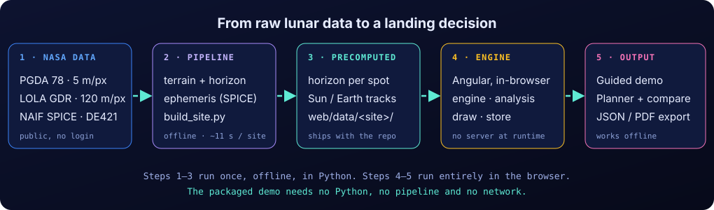

<div align="center">



<br/>


**[The idea](#the-idea) · [See it in action](#see-it-in-action) · [Quick start](#quick-start) · [How it works](#how-it-works) · [Rebuilding the data](#rebuilding-the-data) · [Limits](#honest-limits)**

</div>

---

## The idea

Most landing-site analysis asks one question: *is this exact point good?*

Real landers do not touch down on the exact point. They land somewhere inside a **drift circle** around it. SHOTSPOT asks the better question:

> **How much of the ground around my aim point is still good if I miss?**

SHOTSPOT is a miss-tolerant landing planner for the **lunar south pole**. It combines real NASA terrain with real Sun and Earth geometry, then scores not just a point but the whole area a lander could plausibly reach. When the area is fragile, it finds a better aim point under the **same** mission conditions.

---

## See it in action

<div align="center">

</div>

This loop replays the guided demo on its fixed scenario: **Site20 · 13 Dec 2026 · 10 days**.

| Stage | What happens | Result |
|:--:|---|:--:|
| **1 · Pass** | The aim point passes every test. With an assumed 100 m drift, the area around it looks great. | **~95%** |
| **2 · Drift** | Same place, same date, same conditions, but the lander may touch down 400 m away. The point still passes; the neighbourhood does not. | **~69%** |
| **3 · Re-aim** | The engine searches for a better aim under the same 400 m drift. The recommendation sits about **216 m** from the original aim. | **~84%** |
| **4 · Decide** | The aim marker moves. The old point and the old number stay on screen, so the change can be audited. | **69% → 84%** |
| **5 · Evidence** | Data sources, the core assumption and the full planner are one click away. | n/a |

We never relax the mission to flatter the result. We move the aim.

> **What the percentage means.** It is the *share of analysed spots inside the assumed drift circle that meet the chosen constraints*. It is **not** the probability that a real mission succeeds. The demo's raw values are 94.6%, 69.3% and 83.5%, rounded on screen.

The demo scenario uses this constraint profile: 40% Sun, 50% Earth, 72 h maximum dark period, 48 h Earth outage, 8° slope. The 100 m and 400 m drifts are illustrative examples, not official NASA requirements.

---

## Features

- **Guided demo** (about 85 seconds): one big map, one big number, one question at a time. Autoplay, pause, step through chapters, replay.
- **Full planner**: pick a site, a mission window and a drift radius, then compare sites and dates side by side.
- **Recommended aim**: the engine finds a more drift-tolerant point and shows the before and after.
- **Persistent comparison**: the original result never disappears after you apply a recommendation.
- **Real geometry**: terrain horizon per spot (360 azimuths, out to 250 km) plus Sun and Earth positions from NAIF SPICE.
- **Export**: JSON (scenario, comparison, assumptions) and a printable PDF view.
- **Fully offline**: no backend, no API keys, no network at runtime. Fonts and data are bundled.
- **Accessible**: keyboard navigation, screen-reader labels on chapters, and reduced-motion support.

---

## Quick start

You only need **Node.js 22.12+**. No Python, no pipeline, no internet.

```bash
git clone <your-repo-url>
cd <your-repo-folder>
```

| Platform | Run |
|---|---|
| Windows | double-click `START-DEMO.bat` |
| macOS / Linux | `./start-demo.sh` |
| Any | `node scripts/serve.mjs` |

Then open **http://localhost:4200**. Choose **Watch the demo** for the guided story or **Try your own scenario** to open the planner directly. The legacy `/demo` and `/planner` links open the same experience.

Stop the server with `Ctrl+C`.

<details>
<summary><b>Use another port</b></summary>

```bash
PORT=4201 node scripts/serve.mjs
# or
PORT=4201 ./start-demo.sh
```

Windows Command Prompt:

```bat
set PORT=4201
START-DEMO.bat
```

</details>

<details>
<summary><b>Why not just double-click index.html?</b></summary>

The app is a single-page Angular application. The bundled server provides the page fallback and the correct MIME types for binary data and fonts, which browsers do not give you for `file://` URLs. The server is dependency-free, rejects path traversal, and returns a real `404` for missing assets instead of an HTML page.

</details>

---

## How it works

<div align="center">

</div>

| Layer | Where | What it does |
|:--:|---|---|
| **1 · Terrain** | `pipeline/terrain.py` | Loads LOLA DEMs and handles polar-stereographic math. |
| **2 · Horizon** | `pipeline/horizon.py` | Computes the terrain horizon for every spot: 360 azimuths, out to 250 km (numba). |
| **3 · Ephemeris** | `pipeline/ephemeris.py` | Sun and Earth azimuth and elevation from NAIF SPICE (`MOON_ME`, DE421). |
| **Build** | `pipeline/build_site.py` | Precomputes each site into `web/data/<site>/` and writes `web/data/sites.json`. |
| **4 · Decision** | `frontend/src/app/core/` | The decision engine (`engine.ts`, `analysis.ts`, `draw.ts`, `store.ts`) runs entirely in the browser. |

Because the heavy geometry is precomputed, the browser only has to combine horizons, sky tracks, constraints and a drift circle. That is why the planner feels instant and works offline.

### Sites

Three NASA PGDA 78 sites, each at 5 m per pixel:

| Site | Name | Centre | Size |
|---|---|---|---|
| **Site20** | Leibnitz beta plateau | −85.43° lat, 31.74° lon | 3200 × 3200 px (16 × 16 km) |
| **Site01** | Connecting ridge | −89.46° lat, −137.49° lon | 3200 × 3200 px (16 × 16 km) |
| **Site23** | Malapert massif | −86.00° lat, −0.24° lon | 4200 × 4200 px (21 × 21 km) |

The data window available to the planner runs from **15 Nov 2026 to 15 Nov 2027**.

---

## Repository layout

```text
.
├── frontend/            Angular app (layer 4: the decision engine and UI)
│   └── src/app/core/    engine.ts · analysis.ts · draw.ts · store.ts
├── pipeline/            Python, offline (layers 1-3)
│   ├── terrain.py
│   ├── horizon.py
│   ├── ephemeris.py
│   ├── validate_horizons.py
│   └── build_site.py
├── web/
│   ├── data/            Precomputed site data read by the app
│   └── labeler/         Crater-labelling page for the future AI layer
├── scripts/
│   ├── serve.mjs        Dependency-free static server
│   └── build-release.mjs  Copies the Angular build into ready-to-run/
├── ready-to-run/        Prebuilt browser bundle served by the launchers
├── tests/               Synthetic-terrain tests for the horizon engine
├── docs/assets/         README visuals
├── download_data.sh     Downloads all raw NASA inputs (opt-in, ~856 MB)
├── verify_data.py       Sanity-checks the downloaded PGDA 78 rasters
├── START-DEMO.bat       Windows launcher
├── start-demo.sh        macOS / Linux launcher
└── package.json         Root npm shortcuts
```

---

## Development

From the repository root:

```bash
npm run setup     # install frontend dependencies (npm ci)
npm run dev       # Angular development server
npm run build     # production build, then refresh ready-to-run/
npm start         # serve ready-to-run/ on PORT or 4200
```

`npm run build` is only needed when you change the frontend or when `ready-to-run/` is missing. If the folder is present, the launchers run it as is.

---

## Rebuilding the data

You only need this to re-run the Python pipeline. The app already ships with the processed output in `web/data/`.

**1. Download the raw NASA data** (about 856 MB, 22 files, all public):

```bash
bash download_data.sh        # dry run: lists every file and its size
bash download_data.sh --go   # download everything build_site.py needs
```

<details>
<summary><b>Download options and sources</b></summary>

| What | Saved to | Source |
|---|---|---|
| PGDA 78 LOLA 5 m/px DEMs, 3 sites × 5 layers | `data/raw/pgda78/<Site>/` | [NASA GSFC PGDA product 78](https://pgda.gsfc.nasa.gov/products/78) |
| LOLA GDR polar DEM 120 m/px (far-field terrain) | `data/raw/lola_gdr/` | [NASA PDS Geosciences Node](https://pds-geosciences.wustl.edu/lro/lro-l-lola-3-rdr-v1/lrolol_1xxx/data/lola_gdr/polar/IMG/) |
| NAIF SPICE kernels (`naif0012.tls`, `de421.bsp`, `pck00010.tpc`, `moon_pa_de421_1900-2050.bpc`, `moon_080317.tf`) | `data/spice/` | [NAIF generic kernels](https://naif.jpl.nasa.gov/pub/naif/generic_kernels/) |

Options: `--sites "Site20"` and `--files "surf slp"` limit the PGDA files, `--clones 1` adds a Monte-Carlo DEM clone, `--no-extras` skips the 120 m DEM and the SPICE kernels, `--s3 s3://bucket/path` also syncs the PGDA files to S3. Interrupted downloads resume when you run the command again.

**Per-site layers**

| Code | Meaning |
|---|---|
| `surf` | DEM elevation (m) |
| `slp` | Slope (degrees) |
| `slperr` | Slope uncertainty (degrees) |
| `toterr` | Total height uncertainty (m) |
| `ldec` | Real LOLA laser shots per pixel (marks weakly constrained terrain) |

**Format:** GeoTIFF, 1 band, `float32`, nodata = NaN, 5 m per pixel, polar stereographic (`+proj=stere +lat_0=-90 +lat_ts=-90 +lon_0=0 +x_0=0 +y_0=0 +R=1737400 +units=m`). Elevations are relative to a 1737.4 km sphere, so negative values are normal. All files of a site share one grid and stack pixel for pixel.

</details>

**2. Verify the rasters:**

```bash
python verify_data.py
```

**3. Run the pipeline:**

```bash
python3 -m venv .venv
.venv/bin/pip install numpy rasterio spiceypy scipy numba pytest requests pillow

.venv/bin/python -m pytest -q tests                        # horizon engine tests
cd pipeline
../.venv/bin/python validate_horizons.py                   # compare with JPL Horizons (needs internet)
../.venv/bin/python build_site.py                          # all sites, ~11 s each (or: build_site.py Site23)
cd ..
```

---

## What is verified

| Check | Result |
|---|---|
| Sun and Earth angles vs NASA JPL Horizons | max difference **0.0001°** over 20 timestamps (target 0.01°) |
| Horizon engine on analytic cases | flat sphere and a 100 m wall at 4 km give **1.366°** with curvature, as expected |
| 5 m tiles vs 120 m polar DEM | mean height difference **1.9 m**, so the two can be stitched |
| Offline run | the final demo test ran with every external request blocked and needed none |

---

## Honest limits

SHOTSPOT is a decision-support and communication tool. It is **not** engineering certification for a lunar landing.

- **Aim point is a demo choice.** The demo aims at the plateau top. The IM-2 Athena landing spot lies outside every PGDA 78 tile.
- **Visibility is geometric.** A body counts as visible when its centre is above the terrain horizon, sampled every 10 minutes. This is not generated power and not link quality.
- **Drift is an input, not a prediction.** It is modelled as a uniform circle over a 30 m spot grid across ±1.2 km.
- **Custom coordinates stay inside the precomputed area.** Points outside the ±1.2 km zone of each site need a pipeline run.
- **The percentage is a share of spots**, not a mission-success probability.

### Not built yet

- AI crater-detection layer (the labelling tool in `web/labeler/` prepares for it)
- More PGDA 78 sites
- Side-by-side comparison with Quickmap / Moon Trek

---

## Credits

- **Terrain:** NASA LOLA / PGDA product 78 (public data).
- **Ephemerides:** NASA NAIF SPICE, validated against NASA JPL Horizons.
- **South-pole context mosaic:** NASA / KARI / ASU LROC / ShadowCam, Shackleton crater. A context illustration only; it is not the Site20 analysis layer.
- **Moon and nebula imagery:** Mohamed Shaaban Astrophotography, used as presentation material, not as analysis data.
- **Fonts:** [Inter](https://rsms.me/inter/) and [JetBrains Mono](https://www.jetbrains.com/lp/mono/), bundled locally under the SIL Open Font License.

<div align="center">
<br/>
<sub>Don't plan for a perfect landing. <b>Plan for the miss.</b></sub>
</div>
